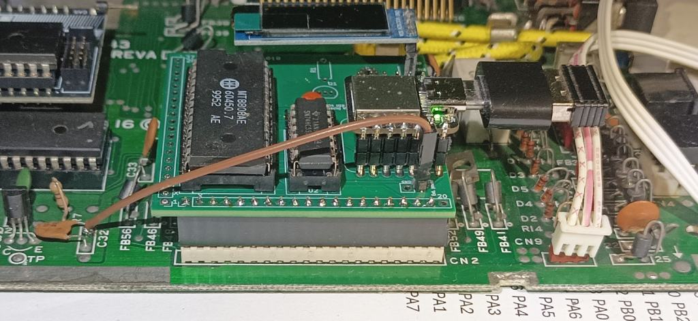
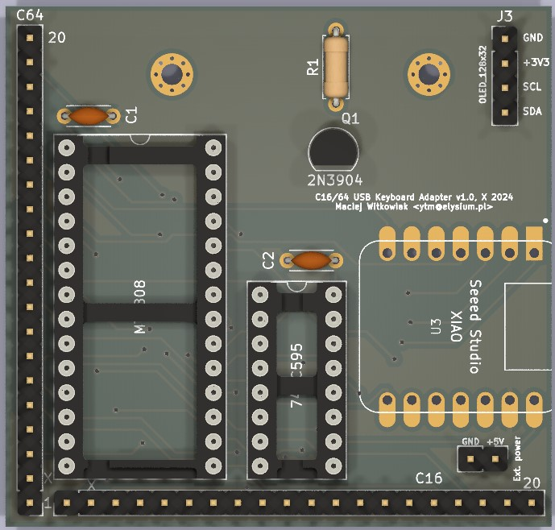
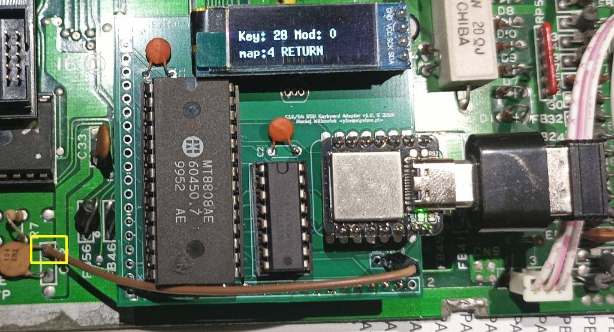

# C16 USB Keyboard

This project is designed to allow a modern USB keyboard to be used with a Commodore C16 or Commodore C64 instead of the original Commodore keyboard.

It is intended to be plugged into the internal 20-pin keyboard connector.

This project was forked from the [C128 USB Keyboard project](https://github.com/ytmytm/C128-keyboard),
which was based on [Hartland/C64-Keyboard](https://github.com/Hartland/C64-Keyboard).
The hardware and firmware have been adapted to the C16 keyboard matrix and MT8808 switch chip.

Only the USB interface is retained; PS/2 keyboards are becoming retro themselves.

This project requires a Seeed Studio XIAO SAMD21, which has a USB-C socket. Use a USB-A female to USB-C male OTG adapter to connect a standard PC keyboard.



-- Maciej 'YTM/Elysium' Witkowiak

<!--- <a href="https://www.pcbway.com/project/shareproject/C128_USB_Keyboard_adapter_dcf19251.html"></a> -->

# Features

- supports USB HID boot-protocol keyboards, including compatible wireless USB receivers
- C16 positional and symbolic maps switchable on the fly
- OLED display support
- adapter can be plugged directly into keyboard port

# PCB and schematic

Use KiCad to open the project in [kicad-c128keyb](kicad-c128keyb/) folder.

In the [kicad-c128keyb/plots](kicad-c128keyb/plots) you will find ready to use Gerber files for manufacturing
as well as [schematic](kicad-c128keyb/plots/kicad-c128keyb.pdf)

Use the Gerber files from this repository when ordering the C16 PCB.

## Parts



* SEEED XIAO SAMD21 (important: SAMD21, not RP2040)
* U1: MT8808
* U2: 74HCT595
* C1, C2: 100n capacitors
* pin headers and sockets
* 128x32 SSD1306 I2C OLED display (optional)

C16 option:

* use J5 as keyboard connector
* J4 to provide power, connect +5V to the square pad
* don't install Q1 and R1

C64 option:

* use J2 as keyboard connector
* Q1: 2N3904 transistors (or any other NPN, like S9013)
* R1: 10K resistors

### C16 option

There is no +5V pin connected to keyboard connector in C16. Connect +5V from anywhere inside computer (e.g. one of the legs of C22 - yellow square on the photo below) to the square pad of J4.




### Restore key (C64 only)

Install Q1 and R1.

# Firmware

The sketch is in [SEEED/C16_keyboard](SEEED/C16_keyboard/). Keep all files in
that folder together when copying it to another computer.

## Install and upload with Arduino IDE

1. Install the **Seeed SAMD Boards** package and select the **Seeeduino XIAO**
   board (SAMD21). Follow the [Seeed setup instructions](https://wiki.seeedstudio.com/Seeeduino-XIAO/#software)
   to add the board package URL if necessary.
2. Use the Library Manager to install **[U8g2](https://github.com/olikraus/U8g2_Arduino)**
   and **[ShiftRegister74HC595](https://github.com/Simsso/ShiftRegister74HC595)**.
   U8g2 is required to compile the sketch even when no OLED is connected.
3. Download **`SEEED/C64_USB_Host_Library_SAMD.zip` from this repository**
   ([download the matching ZIP](SEEED/C64_USB_Host_Library_SAMD.zip)). In the IDE,
   choose **Sketch > Include Library > Add .ZIP Library** and select that local
   file. Alternatively, replace the installed library with this checkout's
   [source directory](SEEED/C64_USB_Host_Library_SAMD).
   A generic USB host library is not a substitute for this modified version.
4. Open [C16_keyboard.ino](SEEED/C16_keyboard/C16_keyboard.ino) in the Arduino IDE.
5. Disconnect the USB keyboard/OTG adapter and connect the XIAO's USB-C port
   to the computer with a USB data cable. Select the board's port and upload.
   If the port is missing or upload fails, enter the bootloader as described
   below, select its port, and try again.
6. Disconnect the programming cable, reconnect the keyboard through the OTG
   adapter, and power the adapter using the configuration described above.

Install the matching USB library on **the computer that compiles the sketch**.
Updating only the sketch or the Git checkout does not update an independently
installed library. The sketch rejects older library headers at compile time.

### Replacing the library on Windows

1. Close Arduino IDE and locate the sketchbook folder shown in its Preferences.
   Its library directory is usually `Documents\Arduino\libraries`, but the
   sketchbook may be elsewhere, including under OneDrive.
2. Move the old `C64_USB_Host_Library_SAMD` folder outside the `libraries`
   directory, then extract the current ZIP there. Replace the whole folder.
3. Check that the resulting layout is
   `libraries\C64_USB_Host_Library_SAMD\library.properties`, with no extra
   nested `C64_USB_Host_Library_SAMD` directory.
4. Restart the IDE and compile again. If multiple libraries are reported for
   `KeyboardController.h`, enable verbose compilation output and check the
   selected path. Remove or replace any outdated copy being selected.

On systems that support symbolic links, the installed library directory can
instead link to this checkout's `SEEED/C64_USB_Host_Library_SAMD` directory.
Move the old copy outside `libraries` and restart the IDE after changing it.

## Compile with the checkout's library using Arduino CLI

Run from the repository root. The Seeed SAMD board package, U8g2 and
ShiftRegister74HC595 must already be installed for Arduino CLI.

Bash (Linux/macOS):

```sh
arduino-cli compile \
  --fqbn Seeeduino:samd:seeed_XIAO_m0 \
  --library "$PWD/SEEED/C64_USB_Host_Library_SAMD" \
  SEEED/C16_keyboard
```

PowerShell (Windows):

```powershell
arduino-cli compile --fqbn Seeeduino:samd:seeed_XIAO_m0 --library ".\SEEED\C64_USB_Host_Library_SAMD" ".\SEEED\C16_keyboard"
```

The explicit [`--library` option](https://arduino.github.io/arduino-cli/1.5/sketch-build-process/#dependency-resolution)
has priority over libraries installed in the sketchbook. These commands use
the source directory directly, so no USB library ZIP installation is needed.
They compile the firmware; use the Arduino IDE or an appropriate CLI upload
command to upload it to the board.

The automated build pins Arduino CLI **1.5.1**, Seeed SAMD Boards **1.8.6**,
U8g2 **2.36.19** and ShiftRegister74HC595 **1.3.1**; see
[firmware.yml](.github/workflows/firmware.yml) for the build configuration.

## Entering the bootloader (double reset)

The original XIAO SAMD21 has reset pads rather than an onboard reset button.
To enter its bootloader:

1. Disconnect the keyboard/OTG adapter and connect the XIAO to the computer
   with a USB data cable.
2. Briefly bridge the two **RST reset pads twice in quick succession**, removing
   the bridge between the two touches. See [Seeed's reset-pad illustration](https://wiki.seeedstudio.com/Seeeduino-XIAO/#enter-bootloader-mode)
   for the pad locations. If your board has a reset button, press it twice.
3. The bootloader LED should pulse. With a UF2-enabled bootloader, a removable
   drive normally named **Arduino** appears, containing `INFO_UF2.TXT`.
   A bootloader serial port may also appear; on Windows its COM number may
   differ from the application port. Select that port for an IDE upload.

A single reset restarts the application. **Print Screen on the USB keyboard
only resets the adapter's keys and settings; it does not enter the bootloader.**

## Uploading a UF2 file by copying it to the boot drive

The [XIAO SAMD21 UF2 bootloader supports drag-and-drop flashing](https://wiki.seeedstudio.com/Seeeduino-XIAO-CircuitPython/#installing-circuitpython).
With a UF2-enabled bootloader and a UF2 build of **this project's firmware for
XIAO SAMD21**, no Arduino IDE is needed on the computer doing the upload:

1. Enter the bootloader using the double-reset procedure above.
2. Copy the firmware `.uf2` file to the **Arduino** removable drive using
   Windows File Explorer or your system's file manager.
3. Wait for copying to finish. The board normally restarts automatically and
   the boot drive disappears. Reconnect the keyboard/OTG adapter for use.

Prebuilt firmware is produced by the [Firmware build workflow](.github/workflows/firmware.yml)
and can be downloaded from a successful Actions run or a GitHub Release after
its build completes. The UF2 already contains the compiled libraries; its
recipient does not need Arduino IDE or the USB library ZIP.

Compiled binaries are not tracked in Git. The library ZIP is installed on the
build computer; it is not copied to the board's boot drive.
A `.bin` file cannot be used by simply renaming it to `.uf2`.

### Creating a UF2 from an Arduino build

1. Build for **Seeeduino XIAO (SAMD21)** with the matching USB library, then
   use **Sketch > Export Compiled Binary** in the Arduino IDE. Locate the
   application binary, normally named `C16_keyboard.ino.bin`.
2. Download [uf2conv.py](https://github.com/microsoft/uf2/blob/master/utils/uf2conv.py)
   and [uf2families.json](https://github.com/microsoft/uf2/blob/master/utils/uf2families.json)
   from Microsoft's UF2 project and place them alongside the binary.
3. In that directory, run the conversion with Python 3 (adjust the binary
   filename if your build uses a different one):

   ```sh
   python uf2conv.py --convert --family SAMD21 --base 0x2000 --output C16_keyboard.uf2 C16_keyboard.ino.bin
   ```

Use the application binary from this sketch's XIAO SAMD21 build, without a
bootloader image prepended. The `0x2000` application address matches the
[Seeed XIAO linker configuration](https://github.com/Seeed-Studio/ArduinoCore-samd/blob/master/variants/XIAO_m0/linker_scripts/gcc/flash_with_bootloader.ld).
The conversion only creates the UF2 file; copy it to the boot drive separately.

## OLED and firmware version

The optional display is a **128 × 32 SSD1306 I²C OLED at address `0x3C`**.
The firmware probes for it at startup and skips display operations if it does
not respond. The keyboard functions work without it.

The OLED shows the firmware release date below startup USB status messages,
for example `USB Configuring` / `FW 2026-10-31`. The version also appears below
`USB Running`. Status messages are cleared after about five seconds of
inactivity; key events replace them with the key display.

Set the release date in [firmware_version.h](SEEED/C16_keyboard/firmware_version.h)
when preparing a new firmware release. Recompiling the same source does not
change its version.

## Keyboard compatibility

The USB driver uses HID boot-protocol reports with six ordinary key slots and
separate modifier bits. A keyboard that only supports a proprietary or
NKRO-only report format may not work. Wireless keyboards need a compatible
USB receiver; Bluetooth-only keyboards cannot connect directly.

The adapter reads raw USB HID usages, so the PC's operating-system keyboard
layout does not configure it. The symbolic maps assume US-style key labels.
For troubleshooting, Right Shift should appear as HID usage `0xE5` with
modifier mask `0x20`. `getOemKey()` returns the HID usage; `getKey()` returns
ASCII and is not used to map the Commodore keyboard matrix.

The companion C64 sketch is [SEEED/C64_keyboard/C64_keyboard.ino](SEEED/C64_keyboard/C64_keyboard.ino).
It uses the same modified USB library. Select that folder instead of
`SEEED/C16_keyboard` when building for C64. The C16 firmware has only its
C16 positional and symbolic layouts and no joystick emulation.

## Tests and automated builds

Run the following commands from the repository root with Python 3 and g++ installed:

```sh
python3 tests/test_keyboard_events.py
python3 tests/test_keyboard_events.py C64
python3 -m unittest discover -s tests -p 'test_firmware_artifacts.py' -v
```

The tests exercise the real HID parser and firmware callbacks with mocked
hardware, including simultaneous modifiers, both Shifts, Shift Lock,
differential Shift, shared switches, saved releases, reset and USB reconnect.
See [tests/README.md](tests/README.md).

GitHub Actions runs these tests, compiles both sketches and packages verified
C16 `.bin`, `.elf` and `.uf2` files, build metadata and SHA-256 checksums.
A published release also receives those files. Before publishing, update
`SEEED/C16_keyboard/firmware_version.h`, run the tests and build, commit the
changes and tag that commit `vYYYY-MM-DD` to match the firmware date. Push the
commit and tag, then publish a GitHub Release for that tag to trigger attachment
of the verified firmware files. A tag push alone does not attach release files.
If changing the USB library, rebuild its installation ZIP with
`python3 tools/package_usb_library.py` and commit the updated ZIP too.

# Keyboard mapping

Key maps are defined in [SEEED/C16_keyboard/keymaps.h](SEEED/C16_keyboard/keymaps.h) and [SEEED/C64_keyboard/keymaps.h](SEEED/C64_keyboard/keymaps.h).

You can modify existing ones or add your own.

If you add a new keymap you need to add it to `keymaps[]` array at the bottom of that file. The first key map in that array is the default one.

Press **Pause** to cycle between the two layouts for the selected sketch.
Startup and **Print Screen** reset select the positional layout.
**Scroll Lock** toggles Shift Lock. These settings are not saved across power cycles.

Both physical Shifts, Shift Lock and differential mappings share the C16 Shift
switch. Releases use the mapping saved on key-down, even after a layout change.
Unplugging the USB keyboard clears held keys and Shift Lock.
In the C16 sketch, **Print Screen** clears ordinary held keys and Shift Lock,
selects the positional layout, and restores still-held USB modifiers using that
layout. Release and press an ordinary key again to reactivate it after reset.

The C16 event state uses a fixed table for six ordinary keys and eight modifiers.
The sketch stores its keyboard object statically and prints OLED text directly,
without `std::map`, `new` or Arduino `String` allocations in its own event and
display code.

## C16 positional (default for C16)

This is a mixture of C16/Plus4/C64 and Vice layout.

| USB key | C16 key |
|---------|----------|
| ESC | RUN/STOP |
| F1 | F1 |
| F2 | F4 (shift+F1) |
| F3 | F2 |
| F4 | F5 (shift+F2) |
| F5 | F3 |
| F6 | F6 (shift+F3) |
| F7 | HELP |
| F8 | F7 (shift+HELP) |
| ` ~ | ESC |
| - | + |
| + | - |
| [ | @ |
| ] | * |
| \ | = |
| ; | : |
| ' " | ; |
| Tab | CTRL |
| Caps lock | RUN/STOP |
| Home | CLR/HOME |
| End | RUN/STOP |
| Delete | DEL |
| Backspace | DEL |
| Insert | POUND |
| Page down | Shift+= (left arrow); ignored with Shift |
| Page up | Shift+0 (up arrow); ignored with Shift |
| left CTRL | C= key |
| left/right SHIFT | SHIFT |
| left Windows | ignored |
| right Alt | POUND |
| right Windows | POUND |
| right CTRL | = |
| Print Screen | reset MT8808 switchboard |
| Scroll Lock | Shift Lock |
| Pause | switch to next keymap |
| (keypad) | digits 1-9,0 |
| (cursors) | cursors |

## C16 symbolic

Both physical Shifts map to C16 SHIFT; both Windows keys map to C=.
Right Alt is ignored.

| USB key | C16 key |
|---------|----------|
| ESC | ESC |
| F1 | F1 |
| F2 | F4 (shift+F1) |
| F3 | F2 |
| F4 | F5 (shift+F2) |
| F5 | F3 |
| F6 | F6 (shift+F3) |
| F7 | HELP |
| F8 | F7 (shift+HELP) |
| ` ~ | (left arrow) |
| \ | POUND |
| Tab | CTRL |
| Caps lock | RUN/STOP |
| Home | CLR/HOME |
| End | RUN/STOP |
| Delete | DEL |
| Backspace | DEL |
| left CTRL | CTRL |
| right CTRL | CTRL |
| left Windows | C= key |
| Print Screen | reset MT8808 switchboard |
| Scroll Lock | Shift Lock |
| Pause | switch to next keymap |
| (keypad) | digits 1-9,0 |
| (cursors) | cursors |

As you would expect from standard keycaps, e.g. SHIFT+2 is '@', not '"'.

## C64 positional (default for C64)

This layout works best if you have muscle memory of the original keyboard.

| USB key | C64 key |
|---------|----------|
| ESC | RUN/STOP |
| F1 | F1 |
| F2 | F2 (Shift+F1) |
| F3 | F3 |
| F4 | F4 (Shift+F3) |
| F5 | F5 |
| F6 | F6 (Shift+F5) |
| F7 | F7 |
| F8 | F8 (Shift+F7) |
| F9–F12 | ignored |
| Print Screen | reset MT8808 switchboard |
| Scroll Lock | Shift Lock |
| Pause | switch to next keymap |
| Insert | POUND |
| Home | CLR/HOME |
| Page Up | RESTORE |
| End | RUN/STOP |
| (keypad) | digits 1-9,0 |
| left CTRL | C= key |
| left SHIFT | left SHIFT |
| right SHIFT | right SHIFT |
| AltGr | RESTORE |

## C64 symbolic

As you would expect from standard keycaps, e.g. SHIFT+2 is '@', not '"'.

It uses the same F1–F8 mappings and adapter controls as the C64 positional map.
Other changes:

- Insert maps to INST (Shift+DEL); Delete maps to DEL
- both left and right CTRL mapped to CTRL
- both left and right Windows mapped to C= key
- AltGr is RESTORE
